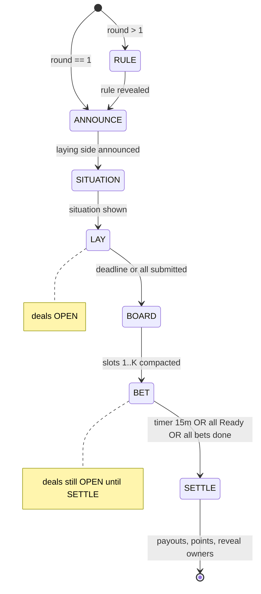

# UFG-1 — state machine тура

Спека: [`01-ufg1-rules.md`](01-ufg1-rules.md), ответы [`09-answers-v3.md`](09-answers-v3.md).

## Уровни

```
Session (катка, до 10 туров)
  └── Round (тур)
        └── phases: RULE → ANNOUNCE → SITUATION → [DEALS open] → LAY → BOARD → BET → SETTLE
```

**Deals** — сквозная подсистема: `OPEN` с начала тура до входа в `SETTLE`.

## Чередование сторон

| Тур | laying (кладут) | betting (ставят) |
|----:|-----------------|------------------|
| 1 | white (чёт) | red (нечёт) |
| 2 | red | white |
| 3 | white | red |
| … | … | … |

Правило `rule_alt_*` может подменить `laying`/`betting` группы; паттерн «одни кладут / другие ставят» сохраняется.

## Фазы тура



### 1. RULE (только тур ≥ 2)
- Тянется/показывается новое правило; корректирующие бьют старые.
- Тур 1: пропуск.

### 2. ANNOUNCE
- UI: «Сейчас карты кладут: **белые** / **красные**».
- «Ставят: …» (противоположная сторона).

### 3. SITUATION
- Рандом карты мемологии (из пула ~30 на игру).
- Шаги 1–3 без искусственной паузы.

### 4. LAY (+ deals OPEN)
- Таймер выбора: **2–3 мин** (конфиг).
- Игроки `laying`: выбрать карту из руки → submit.
- **Pass:** карта **не** уходит из руки.
- **Deadline:** кто не успел = pass.
- Займ/покупка векселя: макс. **1 займ + 1 покупка векселя за тур** (с тура 2 для займа).

### 5. BOARD
- Перемешать выложенные карты.
- Назначить слоты **1…K** (пустые не создаём).
- Владельцы: **открыты** по умолчанию; `rule_hide_owners` скрывает до SETTLE.

### 6. BET (+ deals still OPEN)
- Игроки `betting`: ставки на слоты (не на свой).
- База: 1 монета / 1 слот; правилами — до 3, дробление, догонка ≤3 за тур.
- Кнопка **«Пас»**.
- Завершение фазы:
  - все обязанные сделали ставку или пас; **и**
  - **15 мин** с начала BET **или** все нажали **«Готов»** (ранний финиш).
- ⚠️ уточнить при UX: «Готов» только у `betting` или у всех в туре?

### 7. SETTLE
- Закрыть deals.
- Каждому владельцу слота → перевод кучи с его карты.
- **Траты:** записать все ставки (и прочие расходы тура).
- **Баллы:**
  - `points_top`: +1 (или split) слоту с max кучей;
  - `points_volume`: +N каждому игроку за N поставленных монет.
- Итог тура: слот, карта, **владелец**, сумма, баллы.
- Переход к следующему туру без межфазового «рынка».

## Session-level

- **Early end:** создатель (застолье) → `END_SESSION` → рейтинги по сыгранным турам.
- **Optional pause:** голосование за перерыв (фича `feat_timeout_vote`, не в MVP?).

## Журнал (гроссбух)

Каждое действие = запись без ручного подтверждения:

| event | поля (черновик) |
|-------|-----------------|
| `bet` | round, from_player, slot, amount |
| `payout` | round, to_player, slot, amount |
| `purchase_card` | buyer, seller, price |
| `purchase_voucher` | buyer, seller?, price |
| `loan_bank` | player, amount, voucher_id |
| `team_formed` | captain, members[], payments |
| `rule_added` | round, rule_id |

## Сущности для БД (черновик)

- `GameSession`, `Round`, `RoundRule`, `SituationCard`, `BoardSlot`, `Bet`, `Transaction`, `PlayerWallet`, `Voucher`, `Team`, `PlayerProfile.debt_rub`
